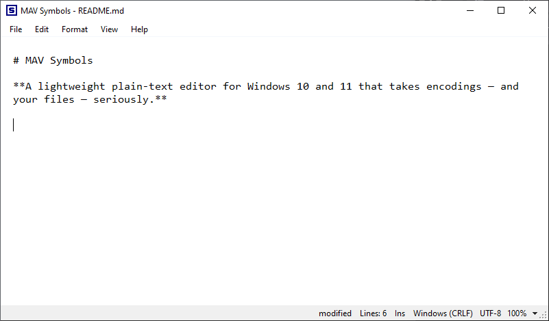
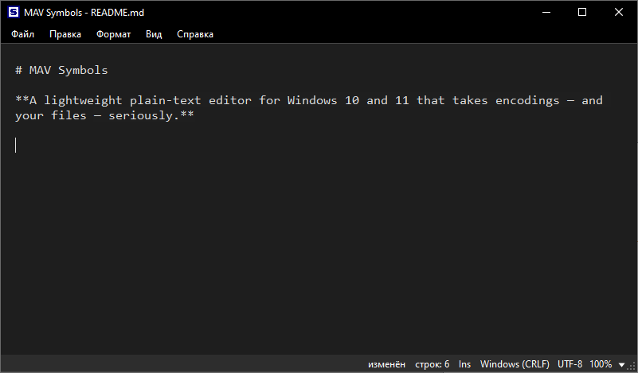
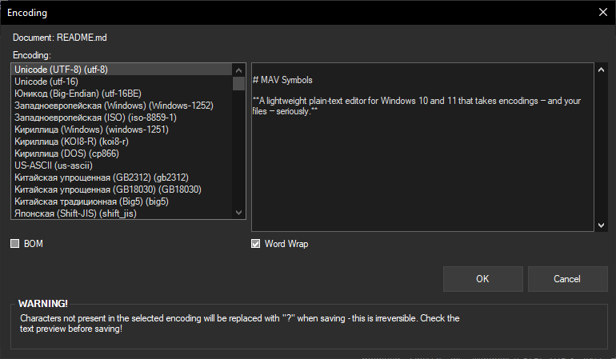

# MAV Symbols

**A lightweight plain-text editor for Windows 10 and 11 that takes encodings — and your files — seriously.**

**English** · [Русский](README.ru.md)

[](LICENSE)


<p align="center"></p>

A classic **plain-text** editor: one window, one document, nothing extra.
It reliably detects encodings (including Cyrillic and CJK), warns you before any character is lost,
saves files **atomically**, and brings your unsaved text back after a crash.

## Features

| | |
|---|---|
| 🔍 **Encodings** | Auto-detection with confidence scores; "Open as…" and "Save in encoding" with live preview |
| 🛡️ **File safety** | Atomic write (temp file → replace), strict decoding, the original is never overwritten by accident |
| ♻️ **Recovery** | Autosave every 30 s; restores your document after a crash or Windows shutdown |
| 🔎 **Find & replace** | Match case, "Replace all" as a single undo step, out-of-memory protection |
| 🖨️ **Printing** | Native Page Setup (margins in mm), page range, word wrap that never splits grapheme clusters |
| 🌗 **Appearance** | Dark theme, RU/EN on the fly, font picker, word wrap, 20–500 % zoom |
| 🧭 **Navigation** | Status bar: line/column, encoding, BOM, CRLF/LF/CR, INS/OVR; go to line |
| 🔗 **Links** | URL highlighting and safe opening, search the selection in Yandex or Google |
| 📋 **Text** | Plain-text-only clipboard, case conversion, date/time insert, drag & drop |

## Screenshots

| Dark theme | Save in encoding — live preview |
|:---:|:---:|
|  |  |

## Encodings

`UTF-8` · `UTF-16 LE/BE` · `UTF-32 LE/BE` · `Windows-1251` · `KOI8-R` · `CP866` · `Windows-1252` · `GB18030` · `Shift_JIS` · `EUC-KR` · system ANSI

BOM can be toggled for every Unicode encoding. Detection order:
**BOM → UTF-16 without BOM → ASCII → strict UTF-8 → statistical models** (letter frequencies, bigrams,
letter case, CJK structure) **→ system ANSI**. Files over 1 MB are analyzed by sampling;
files over 128 MB open only after confirmation. Mixed line endings are normalized on save.

## Keyboard shortcuts

| Keys | Action |
|---|---|
| `Ctrl+C` / `Ctrl+Insert` | Copy (text only, no RTF) |
| `Ctrl+X` / `Shift+Delete` | Cut |
| `Ctrl+V` / `Shift+Insert` | Paste as plain text |
| `Ctrl` + mouse wheel | Zoom |
| `Enter` in find / replace field | Find / Replace |

Native RichEdit shortcuts that apply invisible formatting (`Ctrl+B/I/U`, `Ctrl+E/R/J/L`, etc.) are disabled.

## Build

Visual Studio 2019/2022 with the **".NET desktop development"** workload, .NET Framework.

```powershell
git clone https://github.com/MAV-128/MAV-Symbols.git
```

Open the solution and press **F5**. You can pass a file as an argument (`MAVSymbols.exe "file.txt"`)
or simply drop it onto the window.

## Settings

| What | Where |
|---|---|
| Font, theme, language, zoom, window | `%AppData%\MAV Symbols\settings.mavst` |
| Recovery copies | `%AppData%\MAV Symbols\recovery` |
| Page setup and last printer | `HKCU\Software\MAVPrint\PrintSettings` |

## Limitations

Windows only · plain text only (no syntax highlighting) · one document per window
(use "New window" to work in parallel).

## License

[GNU GPL v3.0](LICENSE) · © 2026 **Andrey Morozov (MAV-128)**