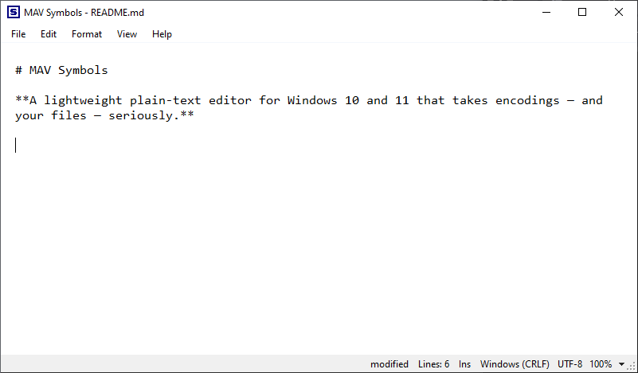
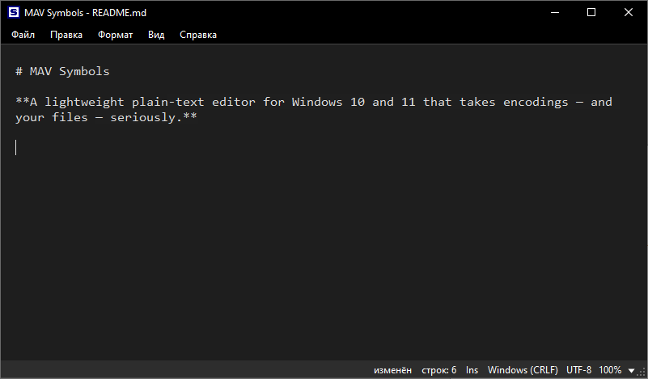
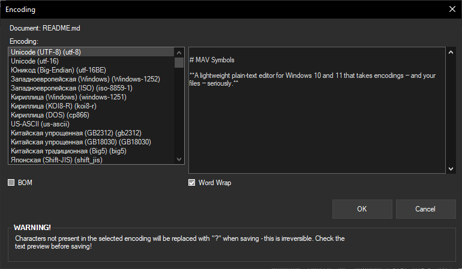

# MAV Symbols

**Лёгкий текстовый редактор для Windows 10 и Windows 11.**

[English](README.md) · **Русский**

[](LICENSE)


<p align="center"></p>

Классический редактор **простого текста**: одно окно — один документ, ничего лишнего.
Уверенно определяет кодировку (включая кириллицу и CJK), предупреждает о потере символов,
сохраняет файл **атомарно** и возвращает несохранённый текст после сбоя.

## Возможности

| | |
|---|---|
| 🔍 **Кодировки** | Автоопределение с оценкой уверенности; «Открыть как…» и «Сохранить в кодировке» с живым превью |
| 🛡️ **Сохранность** | Атомарная запись (временный файл → подмена), строгое чтение, защита оригинала от перезаписи |
| ♻️ **Восстановление** | Автосохранение каждые 30 с; возврат документа после сбоя или выключения Windows |
| 🔎 **Поиск и замена** | Учёт регистра, «Заменить всё» одним действием отмены, защита от нехватки памяти |
| 🖨️ **Печать** | Нативные параметры страницы (поля в мм), диапазон страниц, перенос по словам без разрыва графем |
| 🌗 **Вид** | Тёмная тема, RU/EN на лету, выбор шрифта, перенос по словам, масштаб 20–500 % |
| 🧭 **Навигация** | Статусбар: строка/столбец, кодировка, BOM, CRLF/LF/CR, INS/OVR; переход к строке |
| 🔗 **Ссылки** | Подсветка и безопасное открытие URL, поиск выделенного в Яндексе и Google |
| 📋 **Текст** | Буфер обмена только как plain text, смена регистра, вставка даты/времени, drag & drop |

## Скриншоты

| Тёмная тема | Сохранение в кодировке — живое превью |
|:---:|:---:|
|  |  |

## Кодировки

`UTF-8` · `UTF-16 LE/BE` · `UTF-32 LE/BE` · `Windows-1251` · `KOI8-R` · `CP866` · `Windows-1252` · `GB18030` · `Shift_JIS` · `EUC-KR` · системная ANSI

BOM переключается для всех Unicode-кодировок. Порядок детекции:
**BOM → UTF-16 без BOM → ASCII → строгий UTF-8 → статистические модели** (частоты букв, биграммы,
регистр, структура CJK) **→ системная ANSI**. Файлы больше 1 МБ анализируются выборкой,
больше 128 МБ открываются только с подтверждением. Смешанные переводы строк приводятся к одному типу.

## Горячие клавиши

| Клавиши | Действие |
|---|---|
| `Ctrl+C` / `Ctrl+Insert` | Копировать (только текст, без RTF) |
| `Ctrl+X` / `Shift+Delete` | Вырезать |
| `Ctrl+V` / `Shift+Insert` | Вставить как простой текст |
| `Ctrl` + колесо | Масштаб |
| `Enter` в поле поиска / замены | Найти / Заменить |

Нативные сочетания RichEdit для невидимого форматирования (`Ctrl+B/I/U`, `Ctrl+E/R/J/L` и др.) заблокированы.

## Сборка

Visual Studio 2019/2022 (нагрузка «Разработка классических приложений .NET»), .NET Framework.

```powershell
git clone https://github.com/MAV-128/MAV-Symbols.git
```

Откройте решение и нажмите **F5**. Файл можно передать аргументом (`MAVSymbols.exe "file.txt"`)
или просто перетащить в окно.

## Настройки

| Что | Где |
|---|---|
| Шрифт, тема, язык, масштаб, окно | `%AppData%\MAV Symbols\settings.mavst` |
| Копии восстановления | `%AppData%\MAV Symbols\recovery` |
| Параметры печати и принтер | `HKCU\Software\MAVPrint\PrintSettings` |

## Ограничения

Только Windows · только простой текст (без подсветки синтаксиса) · один документ на окно
(параллельная работа — пункт «Новое окно»).

## Лицензия

[GNU GPL v3.0](LICENSE) · © 2026 **Андрей Морозов (MAV-128)**